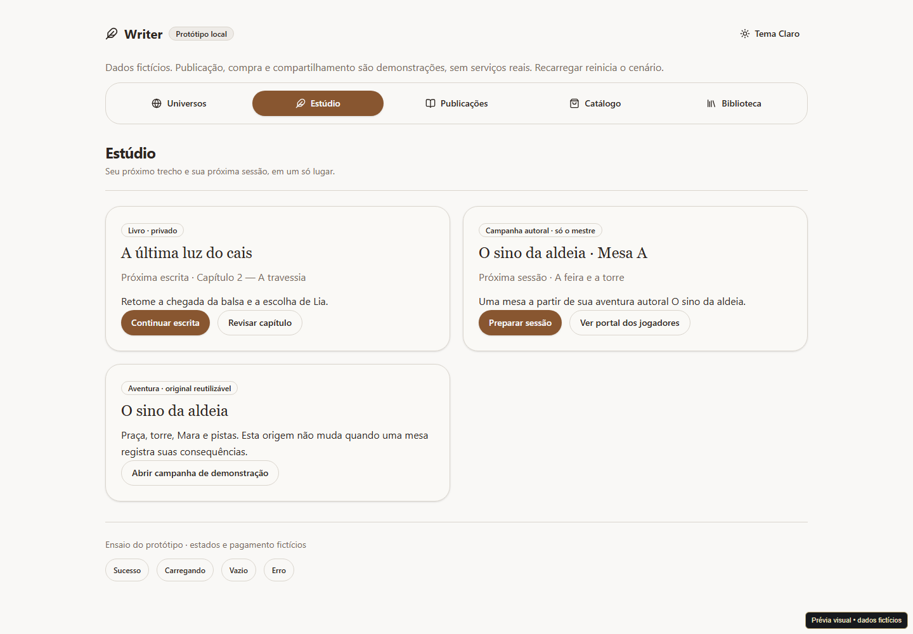

# Writer V2 — Protótipo das jornadas e roteiro de pilotos

- **Data:** 2026-10-13.
- **Branch/base:** `codex/writer-v2`, `24ad41e`.
- **Plano:** [W2-F1-05](../tasks/writer-v2/fase-01-direcao-e-fundamentos/05-prototipos-e-pilotos.md).

## Resultado

Protótipo navegável em Universos, Estúdio, Publicações, Catálogo e Biblioteca.
Livro e campanha têm próxima atividade no mesmo peso. Escrita/restauração/revisão,
preparação/revelação/portal/consequências e compra/biblioteca têm demonstrações
interativas e estados de carregamento/vazio/erro/sucesso. Campanha autoral e adquirida
são separadas; aquisição suspensa/revogada bloqueia material derivado pelos atalhos,
preservando notas próprias. Motivo de revogação distingue refund de disputa perdida.

Operador aprovou explicitamente os cinco espaços com livros, aventuras e campanhas
no Estúdio, após ver o protótipo. Roteiro preparado para três autores e três mestres;
não houve recrutamento, observação humana, cobrança, convite real ou publicação externa.

## Artefatos

| Arquivo                                                                        | Papel                                                 |
| ------------------------------------------------------------------------------ | ----------------------------------------------------- |
| [Contrato de execução](../tasks/writer-v2/execucao/05-prototipos-e-pilotos.md) | Plano, comandos, resultados, aprovação e limites      |
| [Roteiro de piloto](../tasks/writer-v2/execucao/05-roteiro-de-pilotos.md)      | Consentimento, tarefas, variantes e registros vazios  |
| e2e/visual/writer-v2.html, writer-v2-prototype.tsx e CSS Module                | Entrada isolada e UI com componentes/temas existentes |
| e2e/visual/writer-v2-prototype.visual.ts                                       | Cinco testes observáveis em seis projetos Chromium    |
| Índices, tarefa e decisões                                                     | Estado real e navegação aprovada                      |

Vite visual serve somente localmente, recusa build produtivo e bloqueia rede externa.
Entrada disponível em `/e2e/visual/writer-v2.html`. Sem nova rota produtiva ou código
em `src/features`; artefato é infraestrutura de prototipação, não implementação das
features de campanhas/comércio. Busca de marcadores do protótipo no JS do bundle
produtivo não encontrou ocorrências. CSS utilitário é compartilhado pelo scanner Tailwind.

## Validação real

| Verificação                                                               | Resultado                                                                                                        |
| ------------------------------------------------------------------------- | ---------------------------------------------------------------------------------------------------------------- |
| Playwright final                                                          | **30 passaram**, 54,8 s; cinco testes × claro/escuro/sépia desktop/mobile                                        |
| 320 px                                                                    | Dois percursos por projeto em 320 × 720; sem overflow, Dialog dentro da viewport                                 |
| Teclado/foco                                                              | Enter para escrita/navegação; Escape cancela e retorna foco; restauração exige confirmação                       |
| Negativos do protótipo                                                    | Pendente não libera; suspensão/integral/perda bloqueiam edição e derivados pelos atalhos; notas ficam acessíveis |
| Isolamento                                                                | Testes registram zero requests externos necessários e zero pageerrors                                            |
| npm run validate após correções                                           | Código 0; gates completos passaram                                                                               |
| Frontend/cobertura                                                        | 116 arquivos, 851 testes; 92.84% statements, 86.41% branches, 91.32% functions, 94.93% lines                     |
| Backend/syntax                                                            | 87 testes passaram, zero falhas; syntax check passou                                                             |
| Scripts, arquitetura, docs, styleguide, formato, lint, tipo, build, smoke | Passaram no gate                                                                                                 |
| Revisão independente                                                      | Três achados corrigidos e reconferidos; sem bloqueador remanescente                                              |
| Inspeção manual                                                           | Screenshots claro/escuro/sépia e sessão autoral no navegador Edge                                                |

Build mantém avisos de chunks grandes/importação dinâmica ineficaz de exportDocx.
Registro final documental vem depois do gate; docs/formato scoped/diff são repetidos.
Não reduzir cobertura nem confundir testes do protótipo com regras ou backend V2.

## Evidência visual

Screenshots finais, com dados fictícios e identificação de protótipo:

[Estúdio escuro](assets/writer-v2-prototipo-2026-10-13/estudio-escuro.png) ·
[Confirmação de revelação sépia a 320 px](assets/writer-v2-prototipo-2026-10-13/revelacao-sepia-320.png).

## Limites e pendências

Sem persistência/autorização/remediação real, colisão entre abas, EPUB/ZIP ou pagamento
remoto. Compra simulada usa aventura; checkout do livro continua na implementação
financeira futura. Conto tem amostra e preparação de edição demonstradas.
Ausência de segredo no DOM do portal não comprova segurança de servidor/cache/arquivos.

Pilotos permanecem não executados. Operador ainda define participantes, critérios
e tratamento de observações antes da coleta. A navegação foi aprovada, não a aceitação
geral do produto. CI no PR não foi executada; não houve push ou deploy.

Próximo incremento: W2-F1-06 consolida contratos/documentação e reestima a timeline,
mantendo condições comerciais/humanas externas explícitas e o escopo integral V2.
