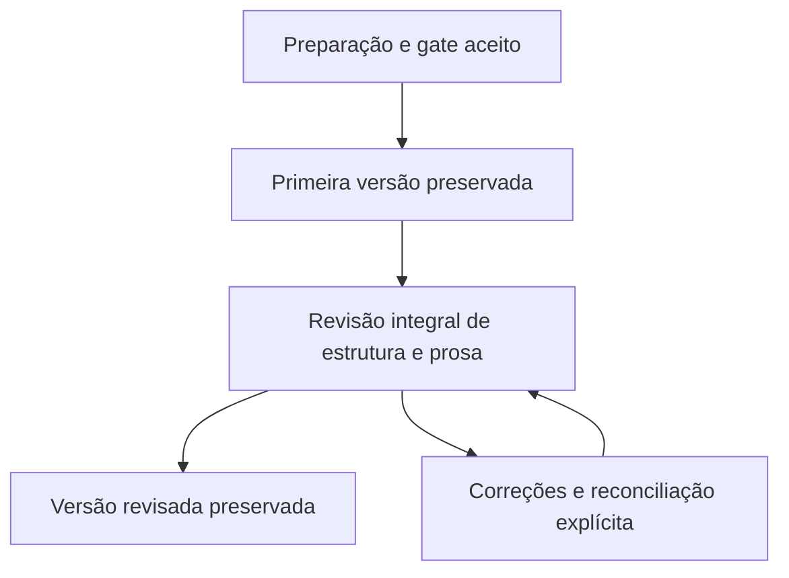

# Ciclo editorial privado de um capítulo — coordenação de E4

Implementação na worktree literária sobre b9fc03c. O objetivo continua sendo o plano
integral de cinco etapas; este incremento conecta as fases de um capítulo e não encerra
formalmente E4 nem as passagens entre capítulos e atos.

## Comportamento

O painel Ciclo editorial do capítulo registra capítulo, modo salvo em E1, orientação,
modelo congelado, fases autorizadas e limites totais de aplicações, créditos e passos.
Registrar não gera texto nem inicia análises. Retomar avança até uma decisão, conflito,
limite ou resposta pendente, usando operações identificadas e recuperáveis.

- A preparação usa os três artefatos e as evidências do gate nativo. O ciclo não inventa
  aceite nem converte capítulos legados. Trabalha em capítulos compostos por cenas;
  conversão continua explícita, com a fonte original preservada.
- Orientação aguarda a escrita manual e sua confirmação antes de capturar a primeira
  versão. Depois oferece a revisão integral, com os aceites autorais previstos.
- Supervisão aguarda autorização da primeira versão, aceites por cena e as passagens
  autorais da primeira versão e da revisão.
- Contínuo executa somente as fases selecionadas. A primeira versão respeita os limites
  do ciclo. Revisão com impedimentos para; avisos e sugestões exigem decisão explícita.
  Revisão sem achados pode passar pelo aceite autorizado, seguido da versão revisada.
- Cada operação avança um passo limitado dos jobs nativos. As cenas e os segmentos são
  completos; limites de execução produzem checkpoint, sem substituir texto por resumo.
- Os checkpoints de redação e revisão podem ser abertos dentro do ciclo. Abrir não
  registra outro job. Fechar sua visualização preserva formulários e operações pendentes.

A conclusão significa que a primeira versão, a revisão aceita e a versão revisada foram
preservadas para este capítulo. A qualidade literária e a integração com ato/livro mantêm
seus próprios critérios e aceites.

## Origem e autorização

`getLiteraryWorkflowScope` consulta metadados próprios de livro/capítulo/contrato. Não lê
manuscrito nem chama provedor. O pedido de registro conserva `expectedScopeToken`,
incluindo dono, alvo, nascimentos nativos, vínculo de ato e revisão do modo de E1. Uma
retomada não recaptura a origem para reaproveitar os mesmos IDs depois de recriação.

O registro começa em registering e só fica active depois de vincular o nascimento nativo
do próprio documento. Se a operação interromper entre essas transações, continua sem
permissão de execução. O autor pode conferir e finalizar o registro original ou cancelá-lo.
Finalizar exige o mesmo escopo capturado; cancelar não ativa os grants.

Avanços e controles carregam `expectedOriginToken` e revisão observada. Recibos conferem
livro, ciclo e ator. Um ciclo copiado/recriado não herda a autorização do documento anterior,
mesmo se os campos e IDs coincidirem. Alterar contrato ou origem interrompe a execução;
modelo/raciocínio congelados não são trocados implicitamente.

## Pausa, recuperação e reconciliação

Pausa e cancelamento atualizam o ciclo e os controles dos filhos na mesma transação.
Uma resposta já registrada pode terminar, mas não aplica prosa depois da pausa ou do
cancelamento. A aplicação continua no commit nativo de manuscrito, crédito e recibo.
Filhos vinculados não podem ampliar os limites fora do grant do ciclo.

Passos usam a mesma operação no replay. O marcador inclui cursors, unidades, aceites e
progresso de capturas manuais/revisadas, evitando consumir a próxima unidade depois de
uma resposta perdida. O passo registrado no servidor pode ser recuperado após recarregar
a página. O journal local conserva somente IDs, revisão e hash do pedido, sem prosa,
instruções ou chaves. Recuperar não cria uma nova operação nem rearma um ciclo cancelado.

Reconciliação de redação fecha o job anterior e conserva seus gastos nos totais. Texto
existente exige adoção explícita, sem sobrescrita automática. Reconciliação de revisão
preserva a primeira versão e abre nova revisão integral sobre o manuscrito atual.

Edição de prosa após a conclusão retira sua condição de atual e exige reconciliação.
Mudança apenas no histórico reaproveita a revisão aceita e reconfere as versões, sem
novas análises por IA. Recibos anteriores e versões preservadas continuam separados do
estado atual e de qualquer autorização de publicação.

## Persistência e integração

- `literaryWorkflowJobs` é uma coleção privada sob o livro, negada ao SDK e incluída na
  limpeza limitada de deleteSceneBook. A marca hasLiteraryResources nasce no registro.
- Recibos permanecem em literaryOperations, somente metadados. Nenhuma coleção filha,
  índice ou dependência nova. Autorizações de execução não são dados portáteis a reativar.
- Seis ações novas usam os setores existentes: cinco em planningApi e advance em
  generationApi. O registro completo tem 422 ações; não foi criada Function por ação.
- Native drafting, review e milestones recebem verificações internas de composição;
  esses callbacks não podem ser fornecidos pelo payload HTTP.

## Evidência e escopo ainda aberto

O relatório local registra os resultados atuais de servidor, cliente, navegador, Rules,
tipos/build e lint. As provas incluem fluxo contínuo e supervisionado, orientação manual,
resposta perdida depois do commit, cancelamento com provedor pendente, origem recriada,
registro interrompido, reuso da revisão e coleta de ciclos órfãos.

E4 ainda exige condições de passagem e coordenação entre capítulos/atos e auditoria final
de todos os critérios de aceite, inclusive relatórios de verificações/correções. Permanecem
a auditoria de E1/E2/E3 e o fechamento de E5 (inventário/backfill/fence/UI de impacto e
portabilidade .writer como nova cópia privada editável). Testes dirigidos não substituem
o gate global; nenhuma das cinco etapas está formalmente encerrada.
